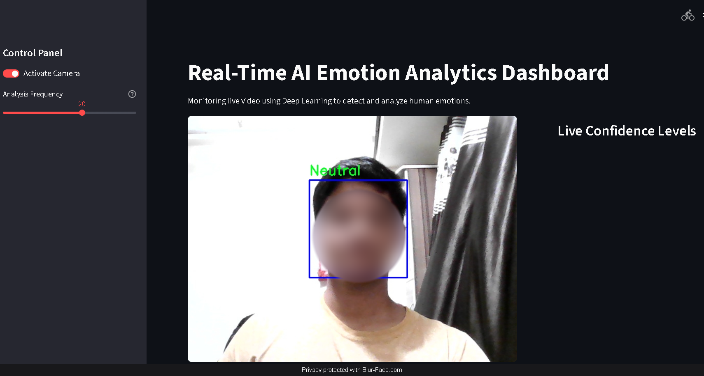

# Real-Time Emotion Detector

A real-time facial expression and emotion analysis web application built with **Streamlit**, **OpenCV**, **DeepFace**, and **Pandas**. It captures live video from your webcam, detects faces, classifies emotions in real time, and logs session analytics.

## Screenshot



## Features
- **Real-Time Facial Emotion Recognition:** Analyzes live webcam frames using **DeepFace** to classify facial expressions (Happy, Sad, Angry, Surprise, Fear, Disgust, Neutral)
- **Live Video Overlay:** Captures camera input and renders bounding boxes and emotion labels smoothly via **OpenCV**
- **Emotion Tracking & Data Logs:** Records detected emotions over time and displays analytics using **Pandas** and **Streamlit**

## Tech Stack
- **Python 3.11**
- **Streamlit** (Interactive web dashboard)
- **DeepFace & TensorFlow (`tf-keras`)** (Facial emotion classification)
- **OpenCV (`opencv-python`)** (Webcam capture & video processing)
- **Pandas** (Emotion logging & session data)

## Setup & Installation
1. Clone the repository:
   ```bash
   git clone https://github.com
   cd realtime-emotion-detector
   ```
2. Install dependencies:
   ```bash
   pip install -r requirements.txt
   ```
3. Run the Streamlit application:
   ```bash
   streamlit run st.py
   ```
